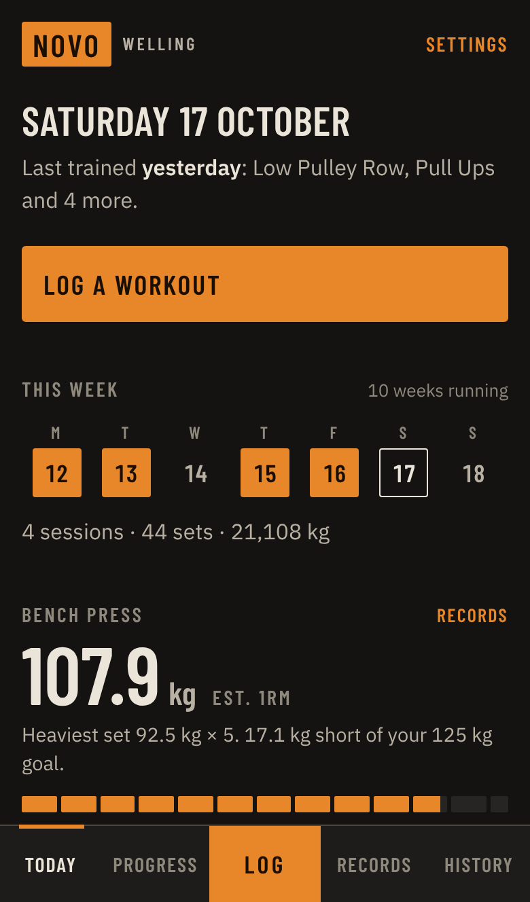
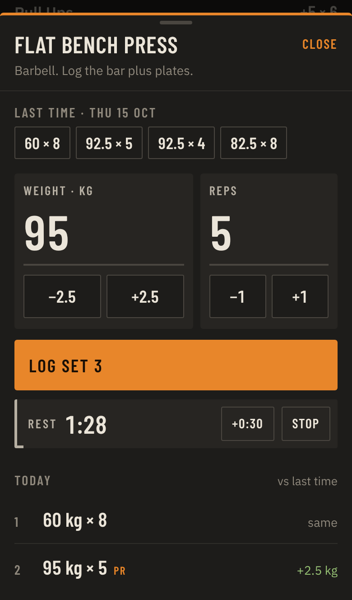
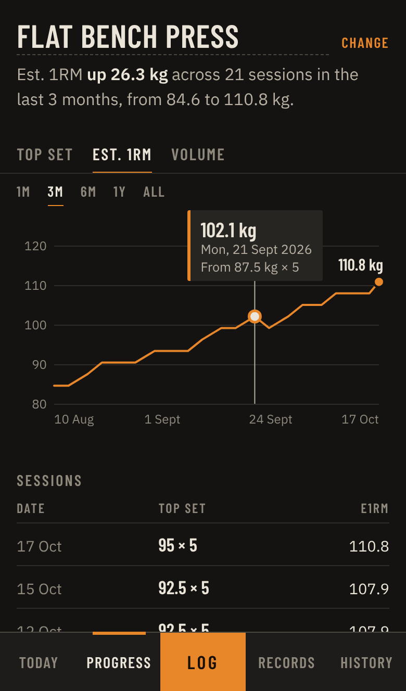
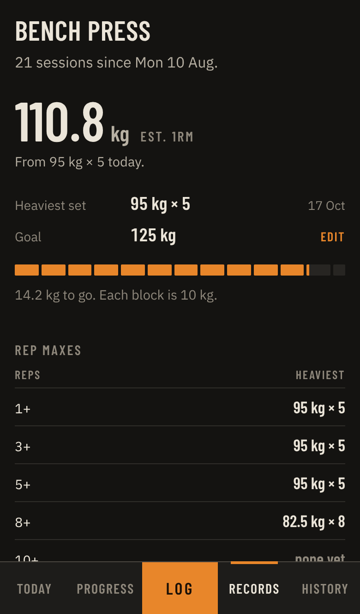

# Novo Tracker

A dark gym log for iPhone, styled after Novo Gym Welling: matte black Primal kit, rubber-floor charcoal, chalk-white type and the burnt-orange feature wall. Orange is the only accent colour, and it always means "do this" or "record".

**Live app:** https://jeryybob9-dot.github.io/Gym-tracker/ (once GitHub Pages is switched on; see below)

| Today | Logging a set | Progress | Records |
| --- | --- | --- | --- |
|  |  |  |  |

These are real screenshots of the app, filled with ten weeks of generated sample training.

## What it does

- **Log**: pick an exercise and set weight and reps with the −2.5 / +2.5 and −1 / +1 steppers. Last session's sets sit above the inputs (tap one to copy it), and each set you log is compared with the same set last time (+2.5 kg, +1 rep, same). Tap a logged set to remove it. There's a rest timer, and you can backfill past dates.
- **Progress**: charts each exercise by top set, estimated 1RM or volume (max reps, added weight or total reps for bodyweight moves) over 1M / 3M / 6M / 1Y / All. The headline is written from your numbers, e.g. "Top set up 17.5 kg across 21 sessions in the last 3 months". Drag along the chart to read any session.
- **Records**: bench press estimated 1RM, heaviest set, an optional goal drawn as 10 kg blocks, rep maxes and your latest records, then the best for every other exercise.
- **Record alerts**: a set that beats your previous best is marked PR, and the alert says exactly what it beat.
- **Today**: this week's training days and totals, and your bench numbers.
- **History**: every session by month. Tap a set to edit or delete it.
- **Settings**: kg/lb, rest timer length, bench goal, your own extra exercises, and backup export/import.

Exercises included: Low Pulley Row, Pull Ups, T-Bar Row, Muscle Ups, Cable Bicep Curls, Preacher Curls, Tricep Push Down, Seated Tricep Dips, Primal Chest Press, Pec Deck, Flat Bench Press and Viking Press.

## Install on your iPhone

1. Open the live link in **Safari**.
2. Tap **Share**, then **Add to Home Screen**.
3. Launch it from the home screen. It runs full screen and works offline.

Your data is stored on your phone only (in the browser's local storage), with nothing sent anywhere. Use **Settings → Backup → Export** now and then, and before switching phones.

## Publish with GitHub Pages (one-time)

1. On GitHub, open the repo, then **Settings → Pages**.
2. Under **Build and deployment**, set **Source** to **Deploy from a branch**.
3. Choose branch **main** and folder **/ (root)**, then **Save**.
4. After a minute or so the site is live at `https://jeryybob9-dot.github.io/Gym-tracker/`.

Every push to `main` redeploys automatically.

## Development

It's plain HTML, CSS and JavaScript modules, with no build step and no dependencies. To run it locally:

```sh
npx http-server -p 8080 .
# then open http://localhost:8080
```

| File | Purpose |
| --- | --- |
| `index.html` | App shell and iPhone web-app meta tags |
| `styles.css` | Palette, type and layout |
| `fonts/` | Barlow Condensed (signage and numbers) and IBM Plex Sans (text), both under the SIL Open Font License and bundled so they work offline |
| `js/app.js` | Screens, sheets, rest timer, events |
| `js/store.js` | Local storage, backup import/export |
| `js/stats.js` | e1RM (Epley), sessions, PR detection, streaks |
| `js/chart.js` | SVG progress chart with touch scrubbing |
| `js/exercises.js` | Exercise list |
| `sw.js` | Offline support (network first, cached fallback) |
| `docs/screenshots/` | README screenshots |

Novo Tracker is an unofficial personal project and isn't affiliated with Novo Gym.
